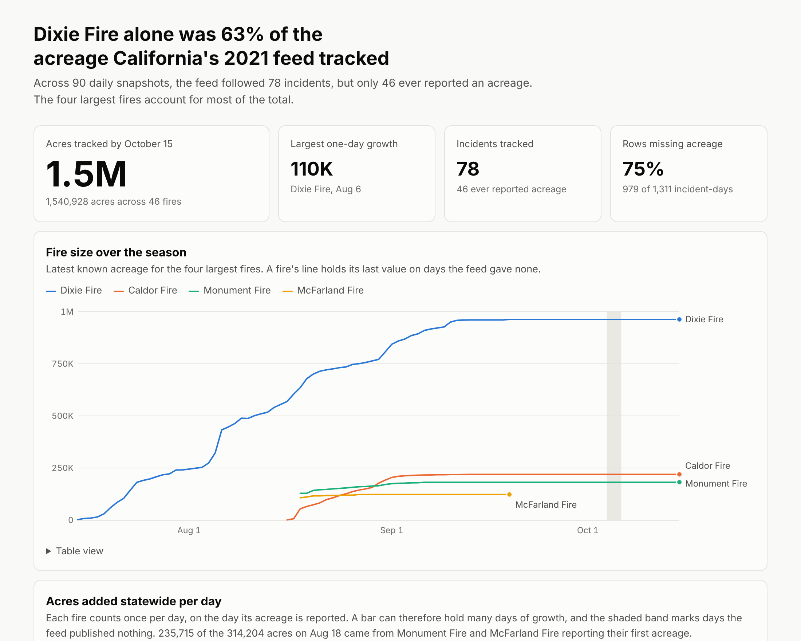
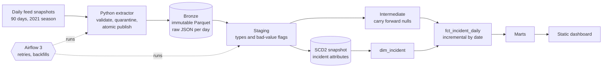

# California wildfire ELT pipeline

A batch pipeline that replays 90 real daily snapshots of California's 2021 wildfire feed into a tested star schema. Rerunning any day leaves every warehouse table hash-identical, and a full backfill through Airflow produces exactly the same warehouse as a direct replay.

**[Open the dashboard](docs/dashboard.html)** (download the file, or serve `docs/` with GitHub Pages)



## The problem

CAL FIRE published a live feed showing only the current state of each active fire, so yesterday's numbers disappeared. To answer "how did this fire grow?", you have to record the feed daily and turn those snapshots into history. The feed is also messy: acreage is missing from 75% of incident-days, one fire had a longitude of -11846461, and the feed published nothing for three days in October.

The dashboard answers one question: which fires drove the 2021 acreage, and how far can the numbers be trusted? The Dixie Fire alone was 63% of the 1,540,928 acres tracked.

## Architecture



| Decision | Why | What I rejected |
| --- | --- | --- |
| Keep raw JSON in bronze | New logic can replay history, and a new source field cannot break ingestion | Typed bronze columns, which lose data when the source changes |
| DuckDB and Parquet | Handles this volume on a laptop at no cost, and runs identically in CI | A cloud warehouse, which adds cost without changing the design at this size. Project 2 covers cloud scale |
| dbt snapshot for SCD2, checked against bronze | A snapshot is stateful and can silently miss a day. A test rebuilds the same history from immutable data and fails on any difference | A snapshot alone, because a skipped day would corrupt history without warning |
| Delete and insert by date for the fact | Each day is replaced as a unit, so reruns are safe | Append, which duplicates rows on retry. Merge by row, which is more complex with no benefit here |
| Carry nulls forward, with a flag | A null means "not stated today", so treating it as zero would invent huge swings | Dropping rows, or filling silently |
| Custom extractor | The source is one dated file per day, so there is no sync state for a tool to manage | dlt or Airbyte. Both make sense for real APIs and SaaS sources |
| Static HTML dashboard | Needs no server, so anyone can open it | Metabase or Evidence, which add a service or build step for a single view |

## Data model

The grain is stated at the top of every model file.

| Table | Grain | Notes |
| --- | --- | --- |
| `fct_incident_daily` | One row per incident per snapshot date | Periodic snapshot. Acres and containment are semi-additive, so never sum them across dates |
| `dim_incident` | One row per version of an incident's attributes | SCD type 2. 121 versions across 78 incidents |
| `dim_date` | One row per calendar date | Includes outage days, so gaps stay visible |
| `dim_county` | One row per California county | From a seed of all 58 counties |
| `bridge_incident_county` | One row per incident per county | Many-to-many, for counts only. The feed gives no per-county acreage |
| `mart_incident_season` | One row per incident | Peak acres, peak one-day growth, days to 50% contained |
| `mart_statewide_daily` | One row per calendar date | Adds each fire's latest known acreage once per date |

The attribute history is real: across the season the feed changed 20 administrative units and 19 county lists, 14 CAL FIRE flags, 2 final flags, and 1 name. A single change can touch more than one attribute.

## Failure scenarios tested

`scripts/prove_idempotency.py` runs these on the full season and writes [the results](docs/proof/idempotency.json). `airflow/run_backfill.sh` produced [the Airflow results](docs/proof/airflow_backfill.json).

| Scenario | Expected result | Result |
| --- | --- | --- |
| Rerun a past day, including the day before an attribute change | All 8 tables hash-identical | Passed |
| Delete a bronze partition, then restore and reprocess it | All 8 tables hash-identical | Passed |
| Rebuild the incremental fact from scratch | Matches the day-by-day build | Passed |
| Backfill all 93 days through a real Airflow 3.3.2 scheduler | Same warehouse as a direct replay | Passed: 93 runs succeeded, no retries, and all 8 tables matched |
| Source publishes nothing (October 4 to 6) | Run is skipped, not failed, and the gap stays visible | Passed |
| Skip a day before an attribute change | The build fails | Passed |
| Duplicate rows in the dimension | The tests fail | Passed |
| Empty feed arrives for a day that already has data | Existing data is kept and the run fails | Passed |
| Over 20% of a day's records are invalid | Nothing is published | Passed |
| A few records are invalid | Those are quarantined and the rest load | Passed |
| Crash during publish | The previous partition stays readable, and a rerun succeeds | Passed |
| Source adds a new field | The field is kept and reported in the manifest | Passed |

Testing also found problems I had not planned for:

- **False SCD2 versions on rerun.** Rerunning an old day compared old attributes with the current version and would have recorded a change that never happened. The snapshot now ignores rows older than an incident's current version.
- **Late reports posing as growth.** After a run of missing values, the next report holds several days of growth at once. Peak daily growth now counts only values reported on two consecutive days. This changes the story: the largest statewide daily gain is 314,204 acres on August 18, but 235,715 of those came from the Monument and McFarland fires reporting their first acreage weeks after they started. The largest true one-day growth is the Dixie Fire's 110,311 acres on August 6.
- **Airflow 3 behavior.** A plain cron string makes a run's logical date its trigger time, which would process the wrong day. The DAG uses `CronDataIntervalTimetable` instead. Airflow 3 also requires a reprocess behavior for backfills on DAGs using `depends_on_past`.
- **A typo in the source.** A range test caught the bad longitude. The value is now nulled and flagged, with the original kept in bronze, because neither stopping the pipeline nor guessing the correction was right.

## Measured results

| Measure | Result |
| --- | --- |
| Rows | 1,311 incident-days from 78 incidents |
| Fixture size | 364 KB |
| Full replay on 2 CPUs | About 9.5 minutes |
| Slim CI on a one-model change | Built 1 model and ran 5 tests, out of 59 nodes in a full build |
| dbt checks | 43 data tests and 4 unit tests. 41 data tests pass and 2 warn by design, reporting the bad coordinate and 9 acreage revisions over 5% |
| Python tests | 13, including 3 end-to-end |
| Running cost | $0 |

Most of the replay time is dbt starting up 90 times, not the data. A scheduled daily run has the same startup cost once.

## What I would change at 100x

- **Move to a lakehouse.** Store bronze in Iceberg or Delta on object storage. DuckDB allows one writer, which limits this project to one run at a time.
- **Stop rebuilding every mart.** Every daily run rebuilds the marts and their tests. At scale, they should be incremental too, with the expensive tests run on the changed partition.
- **Replace the replay source with a live one.** A real source adds retries, rate limits, and partial responses. It also has no second chance: a day the feed is not captured is gone, which is why bronze needs its own backup.
- **Write, audit, then publish.** Today a table can briefly contain data that later fails a test. Project 2 adds isolation, so consumers see a new day only after it passes.
- **Handle replays across a skipped day.** The test detects the problem, but recovery means rebuilding the snapshot in order. At scale I would derive the dimension from bronze and drop the stateful snapshot.

## How to run it

You need [uv](https://docs.astral.sh/uv/getting-started/installation/). The core pipeline commands work on Linux, macOS, and WSL2. Native Windows should work but has not been tested, so WSL2 is the safer choice. Airflow needs Linux, macOS, or WSL2.

```bash
uv sync

# About 2 minutes for the first two weeks. Add no dates for the whole season.
uv run wildfire replay --end 2021-07-29

# Rebuild the dashboard from your warehouse.
uv run python scripts/build_dashboard.py
```

Other commands:

```bash
uv run pytest                              # all tests
uv run python scripts/prove_idempotency.py # every failure scenario, about 15 minutes
airflow/run_backfill.sh                    # full backfill through a real scheduler
```

Generated data goes to `data/local/`. Set `WILDFIRE_DATA_DIR` to put it elsewhere.

## Continuous integration

`.github/workflows/ci.yml` lints Python and SQL, checks types, and runs all tests. On a pull request, `scripts/ci_changed_models.sh` builds the base commit on sample data, then builds and tests only the changed models and everything downstream. I tested that script against a simulated pull request. The workflow itself has not yet run on GitHub.

## Limits of this data

These figures describe what one recorded feed published between July 15 and October 15, 2021. They are not official season totals. Fires outside the feed or without an acreage add nothing. Daily snapshots are the last state of each UTC day, so changes within a day are not captured. See [data/README.md](data/README.md) for the source.
